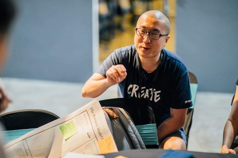
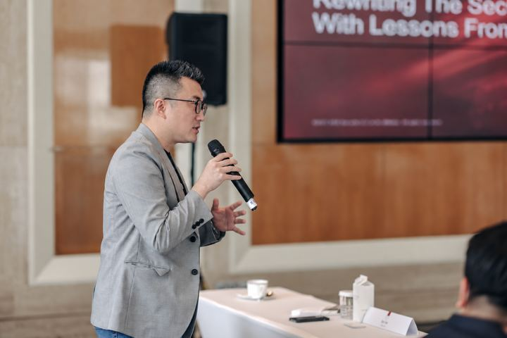
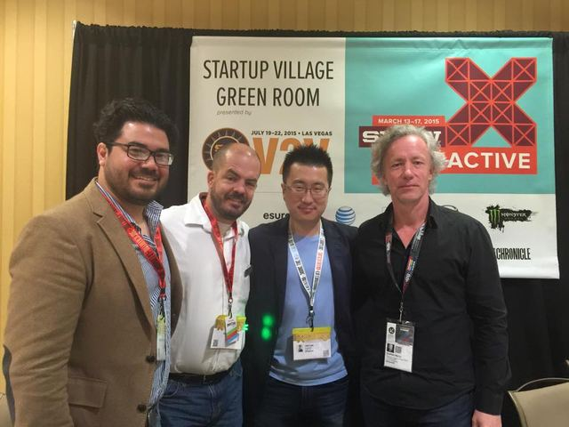

```text
+-------------------------------------------------------------------------------------+
|      _   _    _____ _       _____ _____                                             |
|     | | / \  | ____| |     | ____| ____|                                            |
|  _  | |/ _ \ |  _| | |     |  _| |  _|                                              |
| | |_| / ___ \| |___| |___ _| |___| |___                                             |
|  \___/_/   \_\_____|_____(_)_____|_____|                                            |
|                                                                                     |
| role      AI solution architect                                                     |
| also      Teaching & mentoring Python and AI | Python book author | Startup advisor |
| building  AI agents | RAG | MCP servers | production AI systems                     |
| status    open to consulting | advisory | projects | senior roles                   |
| contact   hello@jael.ee                                                             |
|                                                                                     |
| > type /help to see how we can work together                                        |
+-------------------------------------------------------------------------------------+
```

<div align="center">
  
  <p>
    <a href="https://jael.ee/"></a>
    <a href="https://blog.jael.ee/"></a>
    <a href="https://www.linkedin.com/in/leejaew"></a>
    <a href="https://hubble.social/jaewanglee"></a>
    <a href="https://x.com/leejaew"></a>
    <a href="https://www.youtube.com/c/askjaelee"></a>
    <a href="https://www.amazon.com/author/leejaew"></a>
    <a href="mailto:hello@jael.ee"></a>
  </p>
  <p>
    <a href="#at-a-glance">About</a> ·
    <a href="#work-with-me">Work with me</a> ·
    <a href="#experience">Experience</a> ·
    <a href="#featured-projects">Projects</a> ·
    <a href="#speaking">Speaking</a> ·
    <a href="#writing-and-press">Writing</a> ·
    <a href="#contact">Contact</a>
  </p>
</div>

## At a glance

I build the product and lead the people around it.

| | |
| --- | --- |
| Now | Lead AI solution architect at an AI platform company |
| Scale | More than 70 developers across 8 countries |
| Founder | $3 million seed, 33 US universities |
| Teaching | More than 60 AI classes since June 2026 |
| Product | [Memtoon](https://memtoon.com/), a revenue generating SaaS |

## Work with me

Four ways to start.

| | |
| --- | --- |
| Consulting | Architecture from discovery to delivery. [Email](mailto:hello@jael.ee) |
| Advisory | Founder and operator sessions. [Hubble](https://hubble.social/jaewanglee) |
| Projects | Gateways, agents, MCP, and SaaS. [Projects](#featured-projects) |
| Employment | Senior AI and technology leadership. Former cofounder and CEO, CTO, and VP Engineering. [Experience](#experience) |

## Tech stack

Languages, platforms, and the tools I ship with.

**Languages**

[](https://www.typescriptlang.org/)
[](https://www.python.org/)

**Application**

[](https://react.dev/)
[](https://nodejs.org/)
[](https://expressjs.com/)

**Data and AI**

[](https://www.postgresql.org/)
[](https://github.com/pgvector/pgvector)
[](https://modelcontextprotocol.io/)
[](https://playwright.dev/)
[](https://stripe.com/)

## Experience

Role, company, and years.

| Years | Role | Organization |
| --- | --- | --- |
| Jul 2026 to present | Lead AI solution architect | An AI platform company. Work systems within 60 days. |
| Jun 2026 to present | AI instructor | More than 60 classes for working professionals. |
| Oct 2025 to Dec 2025 | Entrepreneur in Residence | [Antler](https://www.antler.co/), Riyadh. Cofounded FMInsight during the residency for facility management across the GCC. |
| Nov 2024 to Sep 2025 | Digital Director | [MBLM](https://mblm.com/), Dubai. Presales for [allumni.ai](https://www.allumni.ai/). |
| 2024 | Interim CEO | [Madison Technologies](https://madison-technologies.com/). [Salesforce](https://www.salesforce.com/) and [ClickUp](https://clickup.com/) partner. |
| Aug 2022 to Jan 2024 | Cofounder and CEO | Kempus. $3 million seed. 33 US universities. |
| Jan 2021 to Aug 2022 | VP Engineering | [Quincus](https://quincus.com/). More than 70 developers in 8 countries. |
| Dec 2018 to Dec 2020 | CTO | [WorldRoamer](https://www.worldroamer.com/). More than 50,000 listings at MVP. |
| Jul 2017 to Sep 2018 | VP Engineering | [RingMD](https://www.ring.md/). [Ministry of Health](https://www.moh.gov.sg/) sandbox and India's Common Services Centre network. |
| Jun 2016 to Jun 2017 | Director, Creative Technology | GROUP IDD, Seoul. [Samsung](https://www.samsung.com/), [Hyundai](https://www.hyundai.com/worldwide/en), [Kia](https://worldwide.kia.com/en), [L'Oréal](https://www.loreal.com/en/), [3M](https://www.3m.com/), [Burberry](https://www.burberry.com/), [Korea Tourism Organization](https://knto.or.kr/). |
| 2007 to 2009 | University lecturer | [University of Jendouba](https://uj.rnu.tn/), Béja, Tunisia. |

<details markdown="1">
<summary>Earlier roles</summary>

| Years | Role | Organization |
| --- | --- | --- |
| 2013 to 2016 | Founder and CEO | MovableAds, Seoul. Mobile fan engagement. |
| 2012 to 2013 | Lead Software Engineer | [Cheil Worldwide](https://www.cheil.com/), Seoul. |
| 2011 to 2012 | Tech Lead | XenoOne, Seoul. LifeCruz, acquired by [Samsung Group](https://www.samsung.com/) ([Cheil Worldwide](https://www.cheil.com/)). |
| 2010 to 2011 | Cofounder and CTO | Jellycoaster, Seoul. Finger Map and OPTIMAP for [Kia](https://worldwide.kia.com/en). |
| 2009 to 2010 | Founding Lead Developer | BRCH, Seoul. Modubuy.com. |
| 1999 to 2007 | Developer and founder | Seoul. Oneday Mall, Jayster Network, Blooming Daisy Production, Suntech Electronics, and K.E.L. |

</details>

## Featured projects

Name, what it is, and the stack.

| Project | What it is | Stack |
| --- | --- | --- |
| [Memtoon](https://memtoon.com/) | Revenue generating SaaS. A week becomes a manga webtoon. | [](https://claude.com/) [](https://bfl.ai/) |
| [JustRelay](https://justrelay-gcp-frontend.vercel.app/) | Public demo. AI home services concierge for expats in Korea. | [](https://www.typescriptlang.org/) |
| [api.jael.ee](https://api.jael.ee/) | 74 public data APIs and more than 50,000 records across 9 markets. | [](https://api.jael.ee/) |
| Odoo MCP | Search and update Odoo through 17 tools. Read only by default. No public repo. | [](https://www.odoo.com/) [](https://modelcontextprotocol.io/) |
| [VisitKorea MCP](https://github.com/leejaew/visitkorea-mcp) | Open source Korea Tourism Organization data for all 17 provinces and major cities. | [](https://www.python.org/) [](https://modelcontextprotocol.io/) |
| [LLM Gateway](https://gateway.chatforgoodtech.com/) | Multi model inference for an AI platform company, with Stripe billing. | [](https://stripe.com/) |
| [Agent Orchestrator](https://orchestrator.chatforgoodtech.com/) | Chat and browser tasks for an AI platform company. | [](https://playwright.dev/) |

<details markdown="1">
<summary>More projects</summary>

| Project | What it is | Stack |
| --- | --- | --- |
| [VisitKorea Wellness MCP](https://github.com/leejaew/visitkorea-wellnesstourism-mcp) | Wellness tourism search. | [](https://www.python.org/) |
| [VisitKorea Medical MCP](https://github.com/leejaew/visitkorea-medicaltourism-mcp) | Certified medical tourism facilities in South Korea. | [](https://www.typescriptlang.org/) |
| [Singapore MRT Exits MCP](https://github.com/leejaew/sg-mrt-exits-mcp) | 15 tools for Singapore MRT station exits. | [](https://modelcontextprotocol.io/) |
| Agent Memory Dump | Shared agent memory with pgvector search. No public repo. | [](https://modelcontextprotocol.io/) |
| SourceMind | File intelligence and RAG with citations. No public repo. | [](https://modelcontextprotocol.io/) |
| [Ripplet.me](https://ripplet.me/) | Open source discussion platform. | [](https://react.dev/) |
| [Secure Chat](https://github.com/leejaew/secure-chat) | Open source starter for encrypted group chat. | [](https://www.typescriptlang.org/) |
| Chat4Physio | Physio translation proof of concept. No raw audio is stored. No public page. | [](https://www.nuh.com.sg/) |
| Guardian Watch | Child protection early warning for Singapore. No public page. | [](https://telegram.org/) |

</details>

## Speaking

<p align="center">
  
  
</p>
<p align="center">
  Invited panelist, December 2021, <a href="https://www.hilton.com/en/hotels/sincici-conrad-singapore-marina-bay/">Conrad Centennial Singapore</a><br>
  Moderator, <a href="https://w.media/singapore-cloud-datacenter-convention-2021/">Singapore Cloud and Datacenter Convention 2021</a>
</p>

| Year | Role | Event |
| --- | --- | --- |
| 2022 | Speaker | [Digital Week South Asia 2022](https://w.media/digital-week-south-asia-2022/) |
| Dec 2021 | Invited panelist | [Conrad Centennial Singapore](https://www.hilton.com/en/hotels/sincici-conrad-singapore-marina-bay/) |
| 2021 | Moderator | [Singapore Cloud and Datacenter Convention 2021](https://w.media/singapore-cloud-datacenter-convention-2021/) |
| 2021 | Panelist | [Horasis Asia Meeting 2021](https://horasis.org/wp-content/uploads/2021/11/Horasis-Asia-Meeting-2021-programme-1.pdf) |
| 2018 | Speaker | [Cloud and Datacenter Convention, Jakarta](https://www.linkedin.com/feed/update/urn:li:activity:6441245262517202944/) |
| 2013 and 2014 | Speaker | [SXSW](https://www.sxsw.com/), Austin, Texas |

<details markdown="1">
<summary>SXSW photo and more rooms</summary>

<p align="center">
  <br>
  Speaker, <a href="https://www.sxsw.com/">SXSW</a> 2013 and 2014, Austin, Texas
</p>

Also [W.Media](https://w.media/), [PCCW Global](https://www.pccwglobalinc.com/), [NUS Business School](https://bschool.nus.edu.sg/), [James Madison University](https://www.jmu.edu/), [Texas McCombs School of Business](https://www.mccombs.utexas.edu/), and [Konkuk University](https://www.konkuk.ac.kr/eng/index.do).

[Forbes Technology Council](https://www.forbes.com/councils/forbestechcouncil/) notes in 2025 on [AI readiness](https://www.forbes.com/councils/forbestechcouncil/2025/03/19/ensuring-ai-readiness-how-schools-and-industries-can-unite/), [data analysis](https://www.forbes.com/councils/forbestechcouncil/2025/04/15/19-expert-data-analysis-strategies-for-targeted-tech-solutions/), [app performance](https://www.forbes.com/councils/forbestechcouncil/2025/03/06/how-dev-teams-can-continuously-fine-tune-app-performance-expert-tips/), [omnichannel retail](https://www.forbes.com/councils/forbestechcouncil/2025/05/06/barriers-to-effective-omnichannel-retail-and-how-to-solve-them/), and [internal tech systems](https://www.forbes.com/councils/forbestechcouncil/2025/06/24/how-to-build-scalable-reliable-and-effective-internal-tech-systems/).

Books: [Python Programming Beginner's Cookbook](https://www.amazon.com/Python-Programming-Beginners-Cookbook-Jae-ebook/dp/B0CRBG59DM) and [Baseball Inspired Python Tutorial for Beginners](https://www.amazon.com/dp/B0C24LVVJM). Patent: [KR 10-1281095-0000](https://patents.google.com/patent/KR101281095B1/en).

</details>

## Writing and press

Forbes Technology Council notes, and two beginner Python books.

<p>
  <a href="https://www.google.com/search?q=site%3Aforbes.com%2Fcouncils%2Fforbestechcouncil+%22Jae+Lee%22"></a>
  <a href="https://www.amazon.com/author/leejaew"></a>
  <a href="https://blog.jael.ee/"></a>
</p>

| | Book | About | Year |
| --- | --- | --- | --- |
|  | [Python Programming Beginner's Cookbook](https://www.amazon.com/Python-Programming-Beginners-Cookbook-Jae-ebook/dp/B0CRBG59DM) | Beginner Python, with clear examples. | 2024 |
|  | [Baseball Inspired Python Tutorial For Beginners](https://www.amazon.com/Baseball-Inspired-Python-Tutorial-Beginners-ebook/dp/B0C24LVVJM) | Beginner Python taught through baseball. | 2023 |

<details markdown="1">
<summary>Forbes council notes, 2025</summary>

| Date | Title |
| --- | --- |
| Mar 19, 2025 | [Ensuring AI Readiness: How Schools And Industries Can Unite](https://www.forbes.com/councils/forbestechcouncil/2025/03/19/ensuring-ai-readiness-how-schools-and-industries-can-unite/) |
| Apr 15, 2025 | [19 Expert Data Analysis Strategies For Targeted Tech Solutions](https://www.forbes.com/councils/forbestechcouncil/2025/04/15/19-expert-data-analysis-strategies-for-targeted-tech-solutions/) |
| Mar 6, 2025 | [How Dev Teams Can Continuously Fine-Tune App Performance: Expert Tips](https://www.forbes.com/councils/forbestechcouncil/2025/03/06/how-dev-teams-can-continuously-fine-tune-app-performance-expert-tips/) |
| May 6, 2025 | [Barriers To Effective Omnichannel Retail (And How To Solve Them)](https://www.forbes.com/councils/forbestechcouncil/2025/05/06/barriers-to-effective-omnichannel-retail-and-how-to-solve-them/) |
| Jun 24, 2025 | [How To Build Scalable, Reliable And Effective Internal Tech Systems](https://www.forbes.com/councils/forbestechcouncil/2025/06/24/how-to-build-scalable-reliable-and-effective-internal-tech-systems/) |

</details>

## Mentoring

I mentor at [Founder Institute](https://fi.co/), [Wavesparks](https://wavesparks.co/), [Tech Ranch](https://techranchaustin.com/), [ACE.SG](https://www.ace.sg/), [Ignyte](https://www.ignyte.ae/), and [Hubble](https://hubble.social/jaewanglee).

## Contact

Email [hello@jael.ee](mailto:hello@jael.ee). Blog: [blog.jael.ee](https://blog.jael.ee/). [LinkedIn](https://www.linkedin.com/in/leejaew).

<div align="center">
  <p>© 2026 Jae W. Lee · <a href="https://jael.ee/">jael.ee</a></p>
</div>
