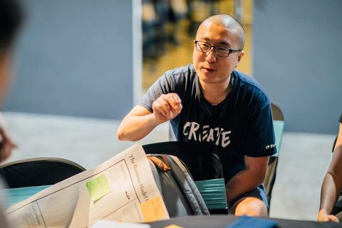
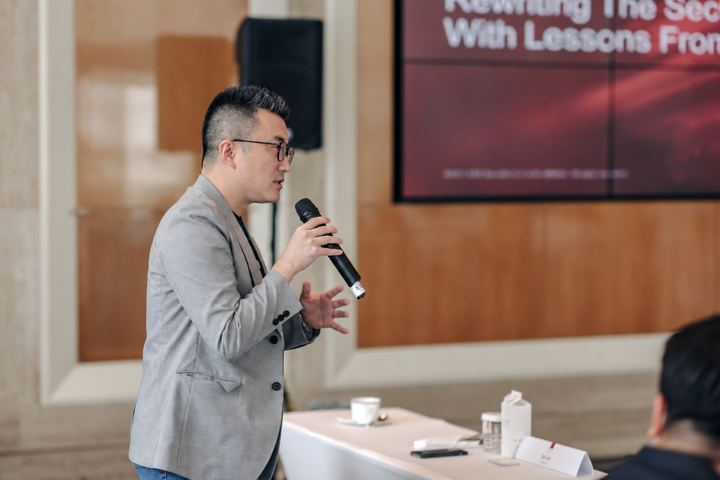
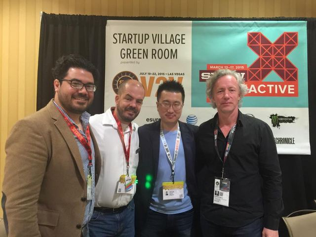
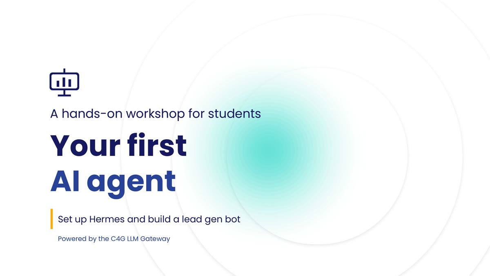

```text
+-------------------------------------------------------------------------------------+
|      _   _    _____ _       _____ _____                                             |
|     | | / \  | ____| |     | ____| ____|                                            |
|  _  | |/ _ \ |  _| | |     |  _| |  _|                                              |
| | |_| / ___ \| |___| |___ _| |___| |___                                             |
|  \___/_/   \_\_____|_____(_)_____|_____|                                            |
|                                                                                     |
| role      AI solution architect                                                     |
| also      Teaching & mentoring Python and AI | Python book author | Startup advisor |
| building  AI agents | RAG | MCP servers | production AI systems                     |
| status    open to consulting | advisory | projects | senior roles                   |
| contact   hello@jael.ee                                                             |
|                                                                                     |
| > type /help to see how we can work together                                        |
+-------------------------------------------------------------------------------------+
```

<div align="center">
  <p class="hero-shot">
    
  </p>
  <p>
    <a href="https://jael.ee/"></a>
    <a href="https://blog.jael.ee/"></a>
    <a href="https://www.linkedin.com/in/leejaew"></a>
    <a href="https://hubble.social/jaewanglee"></a>
    <a href="https://x.com/leejaew"></a>
    <a href="https://www.youtube.com/c/askjaelee"></a>
    <a href="https://www.amazon.com/author/leejaew"></a>
    <a href="mailto:hello@jael.ee"></a>
  </p>
  <p class="site-nav">
    <a href="#at-a-glance">About</a> ·
    <a href="#work-with-me">Work with me</a> ·
    <a href="#experience">Experience</a> ·
    <a href="#featured-projects">Projects</a> ·
    <a href="#speaking">Speaking</a> ·
    <a href="#presentations">Presentations</a> ·
    <a href="#press">Press</a> ·
    <a href="#writing-and-press">Writing</a> ·
    <a href="#education">Education</a> ·
    <a href="#contact">Contact</a>
  </p>
</div>

## At a glance

I am a serial entrepreneur and engineering executive who still ships. I set AI strategy, then architect and build the systems myself. I have been a cofounder and CEO, CTO, and VP of Engineering, delivering for enterprise and government clients in the GCC, Southeast Asia, Korea, India, and the US. I have worked with governments and regulated free zones across Asia and the Middle East.

I designed and built <a href="https://gateway.chatforgoodtech.com/">LLM Gateway</a>, a multi model inference platform with credit accounting and auditable billing, and <a href="https://orchestrator.chatforgoodtech.com/">Agent Orchestrator</a> for chat and browser tasks on that platform. AI projects stall on cost, security, data, or people. I design around those points.

<table>
<tbody>
<tr><td><strong>Scale</strong></td><td>More than 70 developers across 8 countries. <a href="#experience">Experience</a></td></tr>
<tr><td><strong>Teams</strong></td><td>Tech hubs set up and managed in Bulgaria, Ukraine, Vietnam, India, Malaysia, and Singapore, plus offshore partners</td></tr>
<tr><td><strong>Founder</strong></td><td>Multimillion-dollar seed. Expanded to 33 US universities within 6 months of product launch</td></tr>
<tr><td><strong>Teaching</strong></td><td>More than 100 AI lessons since June 2026</td></tr>
<tr><td><strong>Products</strong></td><td><a href="#featured-projects">Project list</a></td></tr>
</tbody>
</table>

**Government and public sector**

- Launched Singapore's first approved telehealth platform under the [MOH Sandbox](https://www.moh.gov.sg/newsroom/moh-launches-first-regulatory-sandbox-to-support-development-of-telemedicine/), at [RingMD](https://www.ring.md/).
- Launched brands and digital experiences for the [Dubai World Trade Centre](https://www.dwtc.com/en/) free zone, including [Dubai Exhibition Centre](https://www.dubaiexhibitioncentre.com/en) and [DWTC Hospitality](https://www.dwtchospitality.com/en/), and built the [VARA](https://www.vara.ae/) online directory and digital onboarding for new and existing license holders and operators, at [MBLM](https://mblm.com/).
- Created startup accelerator programs for [KOTRA](https://www.kotra.or.kr/) (Korea Trade-Investment Promotion Agency), bridging Korea and the US.
- Led the US side of Geeks from Gangnam, a brand experience event that hosted Korean startups backed by [D.CAMP](https://dcamp.kr/).

## Work with me

Four ways to start.

<table>
<tbody>
<tr><td><strong>Consulting</strong></td><td>Architecture from discovery to delivery. <a href="mailto:hello@jael.ee">Email</a></td></tr>
<tr><td><strong>Advisory</strong></td><td>Founder and operator sessions. <a href="https://hubble.social/jaewanglee">Hubble</a></td></tr>
<tr><td><strong>Projects</strong></td><td>Gateways, agents, MCP, and SaaS. <a href="#featured-projects">Projects</a></td></tr>
<tr><td><strong>Employment</strong></td><td>Senior AI and technology leadership. Former cofounder and CEO, CTO, and VP Engineering. <a href="#experience">Experience</a></td></tr>
</tbody>
</table>

## Tech stack

Languages, platforms, and the tools I ship with.

**Languages**

[](https://www.typescriptlang.org/)
[](https://www.python.org/)

**Application**

[](https://react.dev/)
[](https://nodejs.org/)
[](https://expressjs.com/)

**Data and AI**

[](https://www.postgresql.org/)
[](https://github.com/pgvector/pgvector)
[](https://modelcontextprotocol.io/)
[](https://playwright.dev/)
[](https://stripe.com/)

## Experience

Role, company, and years.

| Years | Role | Organization |
| --- | --- | --- |
| Jul 2026 to present | Lead AI solution architect | AI platform company. Led new platform design, development, and launch, reaching recurring revenue within the first 90 days of project start. |
| Jun 2026 to present | AI instructor | More than 100 lessons for business owners and professionals across industries, setting up agentic and autonomous workflows and the first steps toward a self driving organization. Learners in the US, UK, Turkey, Saudi Arabia, Bulgaria, China, Korea, and Switzerland work from their own day to day work. |
| Oct 2025 to Dec 2025 | Entrepreneur in Residence | [Antler](https://www.antler.co/), Riyadh. Cofounded FMInsight during the residency for facility management across the GCC. |
| Nov 2024 to Sep 2025 | Digital Director | [MBLM](https://mblm.com/), Dubai. Led delivery of bilingual Umbraco CMS websites for [DWTC Hospitality](https://www.dwtchospitality.com/en/) and [Dubai Exhibition Centre](https://www.dubaiexhibitioncentre.com/en) at [Dubai World Trade Centre](https://www.dwtc.com/en/). Presales for [allumni.ai](https://www.allumni.ai/). |
| 2024 | Interim CEO | [Madison Technologies](https://madison-technologies.com/). [Salesforce](https://www.salesforce.com/) and [ClickUp](https://clickup.com/) partner. |
| Aug 2022 to Jan 2024 | Cofounder and CEO | Kempus. $3 million seed. Expanded to 33 US universities within 6 months of product launch. Featured in [Forbes](https://www.forbes.com/sites/gilpress/2023/02/27/kempus-is-creating-safe-online-communities-for-university-students/), [TechCrunch](https://techcrunch.com/2023/02/21/kempus-online-student-community/), and [HackerNoon](https://hackernoon.com/kempus-is-what-facebook-was-intended-to-be). |
| Jan 2021 to Aug 2022 | VP Engineering | [Quincus](https://quincus.com/). More than 70 developers in 8 countries. |
| Dec 2018 to Dec 2020 | CTO | [WorldRoamer](https://www.worldroamer.com/). More than 50,000 listings at MVP. |
| Jul 2017 to Sep 2018 | VP Engineering | [RingMD](https://www.ring.md/). [Ministry of Health](https://www.moh.gov.sg/) sandbox and India's Common Services Centre network. |
| Jun 2016 to Jun 2017 | Director, Creative Technology | GROUP IDD, Seoul. [Samsung](https://www.samsung.com/), [Hyundai](https://www.hyundai.com/worldwide/en), [Kia](https://worldwide.kia.com/en), [L'Oréal](https://www.loreal.com/en/), [3M](https://www.3m.com/), [Burberry](https://www.burberry.com/), [Korea Tourism Organization](https://knto.or.kr/). |
| 2007 to 2009 | University lecturer | [University of Jendouba](https://uj.rnu.tn/), Béja, Tunisia. |

<details markdown="1">
<summary>Earlier roles</summary>

| Years | Role | Organization |
| --- | --- | --- |
| 2013 to 2016 | Founder and CEO | MovableAds, Seoul. Mobile fan engagement. Featured in [Forbes](https://www.forbes.com/sites/gbcurley/2015/05/25/south-koreas-startup-culture-marred-by-misguided-ambitions/) and [Hankyung](https://www.hankyung.com/article/2015031695271). |
| 2012 to 2013 | Lead Software Engineer | [Cheil Worldwide](https://www.cheil.com/), Seoul. |
| 2011 to 2012 | Tech lead | Joined a Samsung Group company, [Cheil Worldwide](https://www.cheil.com/), through an acqui-hire, Seoul. |
| 2010 to 2011 | Cofounder and CTO | Jellycoaster, Seoul. Finger Map and OPTIMAP for [Kia](https://worldwide.kia.com/en). |
| 2009 to 2010 | Founding Lead Developer | BRCH, Seoul. Modubuy.com. |
| 1999 to 2007 | Developer and founder | Seoul. Oneday Mall, Jayster Network, Blooming Daisy Production, Suntech Electronics, and K.E.L. |

</details>

## Featured projects

What each project does for the people who use it.

### [Memdoor](https://github.com/guregodevo/memdoor)

Two merged contributions to Memdoor, an open source coding agent. The agent now asks for approval before a delegated workflow starts or resumes, and it stops reviewer reruns when the user presses Stop, so people stay in control of what the agent does.

### [agent-browser](https://github.com/vercel-labs/agent-browser/pull/2746)

A merged contribution to Vercel Labs' agent-browser, a command line tool that lets AI agents drive a web browser. The change makes session capture fail safe, so an incomplete capture never overwrites the last good autosave and users don't lose their saved browser state.

### Grounded RAG

Helps people and teams find answers in their own documents and see exactly where each answer came from. Users set up private workspaces and document collections, invite members, and check the supporting passages and source citations behind every answer. Saved answers stay readable even after a source document is deleted. Users can save questions, give feedback, and bring their own account from OpenAI, Anthropic, OpenRouter, or any OpenAI compatible service. Workspaces are kept separate, roles and signup approval control access, and provider keys are stored encrypted.

### [api.jael.ee](https://api.jael.ee/)

A catalog of more than 150 public data APIs with more than 350,000 records across Southeast Asia, East Asia, the Middle East, Oceania, Europe, and North America. Much of this government and industry data is published only as spreadsheets, PDFs, or web pages. api.jael.ee turns it into clean JSON for developers, researchers, and AI agents, covering hospitals, aged care homes, universities, MRT exits, childcare providers, and more. Every endpoint follows the same simple query rules, so one pattern works in every region. When a query fails, the error names the missing or blocked parameter so an agent can fix its own call. Names in Chinese and Arabic help assistants serve local users, and every source is checked for license and commercial use before it goes live.

### [Memtoon](https://memtoon.com/)

Turns a user's week into a personalized manga webtoon with no drawing or writing needed. Users connect Google Calendar or upload a photo, and Memtoon writes a story from their real events and draws up to 10 panels. A selfie makes the user the main character, drawn the same way in every panel, and the selfie is deleted after use. Generation keeps running if the browser closes, and users can choose to share finished webtoons in a public gallery. Memtoon was named Judge's Favorite at the Replit Agent 4 Buildathon.

<details markdown="1">
<summary>More projects</summary>

### [LLM Gateway](https://gateway.chatforgoodtech.com/)

One place for developers, teams, and AI agents to reach many models through a single OpenAI compatible key. Users manage subscriptions and credits, see their usage, and get streaming chat, image input, voice transcription, and web search without wiring up each provider on their own. Guided installers set up popular coding agents in a few steps. Shared balances stay accurate across apps, provider health checks catch failing models early, and revocable access grants and encrypted credentials keep accounts under control.

### [Agent Orchestrator](https://orchestrator.chatforgoodtech.com/)

An AI chat and browser task app for writing, research, and everyday work across many models. Users sign in with their LLM Gateway account and start right away with their existing subscription or credits, or bring their own model endpoint. The assistant can search the web, read pages, click, and type in a real browser. Long answers keep going past a model's output limit and are saved as one reply. Users pick their search engine, browser automation, default model, and standing instructions, and their chats are saved, exportable to Markdown, and protected by per user encryption.

### [JustRelay](https://justrelay-gcp-frontend.vercel.app/)

Home services in Korea for expats who don't speak Korean. Users describe what they need in one English message, such as a plumber, a cleaner, or a handyman, and an AI concierge finds vetted local providers ranked by fit, distance, and reviews. It then sends the booking inquiry for them, or writes a polite Korean message with natural honorifics that they can paste into KakaoTalk, SMS, or email. It keeps track of scheduling, avoids double bookings, and follows each request until the job is done. Public demo.

### Odoo MCP server

Lets AI assistants work with Odoo ERP through 17 tools for searching records, looking up data models, and making controlled updates across sales, purchasing, inventory, CRM, and other apps, without putting ERP credentials in prompts. It is read only by default. Writes can be previewed first and can require a single use approval tied to that exact change, and allowlists limit which models and actions an agent can touch. It works with Odoo 18, 19, and 20, with local and remote AI clients, and with any model provider. When a write's outcome is uncertain, it says so, so the client can check before retrying. No public repo.

### [VisitKorea MCP server](https://github.com/leejaew/visitkorea-mcp)

Gives AI assistants direct access to the Korea Tourism Organization's official English tourism data for all 17 provinces of South Korea. Any compatible assistant can find attractions, cultural sites, restaurants, places to stay, shopping, leisure, and festivals by area, by keyword, or by distance from a GPS point. It can look up festivals by date and region and pull venue details such as opening hours, admission fees, closing days, parking, room types, menus, and photos. Open source under the MIT license.

### Guardian Watch

An early warning platform for child protection in Singapore. Community members report concerns through Telegram, and officers see them in a secure dashboard. AI sorts incoming reports, a separate rule based engine scores risk for areas and schools, and people review every result before anyone acts. No public page.

### BFG Stride

A prototype for BearyFun Gym that helps staff run student operations and keep families engaged. It handles class scheduling and attendance, flags students who may drop out, and drafts replies to parents that staff review before sending. Permissions by role and by center, plus audit logs, keep data access in check. No public page.

### E-Bridge Inquiry Journal

A prototype for E-Bridge Pre-School that guides teachers through practitioner inquiry, from shaping a structured research question to gathering evidence, writing reflections, and producing reports, with review queues for school leaders. AI stays off until it is turned on on purpose and data handling is approved, and the prototype uses synthetic data only. No public page.

### [DWTC Hospitality](https://www.dwtchospitality.com/en/)

The bilingual corporate website for Dubai World Trade Centre's hospitality division. Guests can explore private events, weddings, corporate and live events, food, venues, and menus, and reach the team quickly. The site presents DWTC Hospitality's premium service in a clear structure that staff can keep current on their own.

### [Dubai Exhibition Centre](https://www.dubaiexhibitioncentre.com/en)

The bilingual corporate website for Dubai Exhibition Centre, presenting it as a global venue for exhibitions, conferences, and large events. Visitors, exhibitors, and organizers each get a clear path to what they need, from venue services and hospitality to advertising, sustainability, and destination information. The content team can update the site themselves as events change.

| Project | What it is | Stack |
| --- | --- | --- |
| [VisitKorea Wellness MCP](https://github.com/leejaew/visitkorea-wellnesstourism-mcp) | Wellness tourism search. | [](https://modelcontextprotocol.io/) [](https://www.python.org/) [](https://www.postgresql.org/) |
| [VisitKorea Medical MCP](https://github.com/leejaew/visitkorea-medicaltourism-mcp) | Certified medical tourism facilities in South Korea. | [](https://modelcontextprotocol.io/) [](https://www.python.org/) |
| [Singapore MRT Exits MCP](https://github.com/leejaew/sg-mrt-exits-mcp) | 15 tools for Singapore MRT station exits. | [](https://modelcontextprotocol.io/) [](https://www.python.org/) |
| Agent Memory Dump | Shared agent memory with pgvector search. No public repo. | [](https://modelcontextprotocol.io/) [](https://www.typescriptlang.org/) [](https://github.com/pgvector/pgvector) |
| SourceMind | File intelligence and RAG with citations. No public repo. | [](https://react.dev/) [](https://expressjs.com/) |
| [Ripplet.me](https://ripplet.me/) | Open source discussion platform. | [](https://react.dev/) [](https://expressjs.com/) |
| [Secure Chat](https://github.com/leejaew/secure-chat) | Open source starter for encrypted group chat. | [](https://developer.mozilla.org/en-US/docs/Web/JavaScript) [](https://expressjs.com/) |
| Chat4Physio | Physio translation proof of concept. No raw audio is stored. No public page. | [](https://react.dev/) [](https://expressjs.com/) |

</details>

## Speaking

Public slides are in [Presentations](#presentations).

<p class="photo-row" align="center">
  
  
</p>
<p align="center">
  Panelist, cybersecurity leaders panel on Zero Trust Architecture, 2021, <a href="https://www.hilton.com/en/hotels/sincici-conrad-singapore-marina-bay/">Conrad Centennial Singapore</a><br>
  Moderator, <a href="https://w.media/singapore-cloud-datacenter-convention-2021/">Singapore Cloud and Datacenter Convention 2021</a>
</p>

| Year | Role | Event |
| --- | --- | --- |
| 2022 | Speaker | [Digital Week South Asia 2022](https://w.media/digital-week-south-asia-2022/) |
| 2021 | Panelist | Cybersecurity leaders panel on Zero Trust Architecture, [Conrad Centennial Singapore](https://www.hilton.com/en/hotels/sincici-conrad-singapore-marina-bay/) |
| 2021 | Moderator | [Singapore Cloud and Datacenter Convention 2021](https://w.media/singapore-cloud-datacenter-convention-2021/) |
| 2021 | Panelist | [Horasis Asia Meeting 2021](https://horasis.org/wp-content/uploads/2021/11/Horasis-Asia-Meeting-2021-programme-1.pdf) |
| 2018 | Speaker | [Cloud and Datacenter Convention, Jakarta](https://www.linkedin.com/feed/update/urn:li:activity:6441245262517202944/) |
| 2013 and 2014 | Speaker | [SXSW](https://www.sxsw.com/), Austin, Texas |

<details markdown="1">
<summary>SXSW photo and more rooms</summary>

<p align="center">
  <br>
  Speaker, <a href="https://www.sxsw.com/">SXSW</a> 2013 and 2014, Austin, Texas
</p>

Also [W.Media](https://w.media/), [PCCW Global](https://www.pccwglobalinc.com/), [NUS Business School](https://bschool.nus.edu.sg/), [James Madison University](https://www.jmu.edu/), [Texas McCombs School of Business](https://www.mccombs.utexas.edu/), and [Konkuk University](https://www.konkuk.ac.kr/eng/index.do).

[Forbes Technology Council](https://www.forbes.com/councils/forbestechcouncil/) notes in 2025 on [AI readiness](https://www.forbes.com/councils/forbestechcouncil/2025/03/19/ensuring-ai-readiness-how-schools-and-industries-can-unite/), [data analysis](https://www.forbes.com/councils/forbestechcouncil/2025/04/15/19-expert-data-analysis-strategies-for-targeted-tech-solutions/), [app performance](https://www.forbes.com/councils/forbestechcouncil/2025/03/06/how-dev-teams-can-continuously-fine-tune-app-performance-expert-tips/), [omnichannel retail](https://www.forbes.com/councils/forbestechcouncil/2025/05/06/barriers-to-effective-omnichannel-retail-and-how-to-solve-them/), and [internal tech systems](https://www.forbes.com/councils/forbestechcouncil/2025/06/24/how-to-build-scalable-reliable-and-effective-internal-tech-systems/).

Books: [Python Programming Beginner's Cookbook](https://www.amazon.com/Python-Programming-Beginners-Cookbook-Jae-ebook/dp/B0CRBG59DM) and [Baseball Inspired Python Tutorial for Beginners](https://www.amazon.com/dp/B0C24LVVJM). Patent: [KR 10-1281095-0000](https://patents.google.com/patent/KR101281095B1/en).

</details>

## Presentations

Public slides. See also [Speaking](#speaking).

### [Your first AI agent](https://speakerdeck.com/leejaew/your-first-ai-agent-by-jae-lee)

StartSomething student entrepreneurship program, Singapore University of Technology and Design. November 17, 2026.

A step by step guide from chatting with a model to an agent that can use tools, save files, and do a job.

<p>
  <a href="https://speakerdeck.com/leejaew/your-first-ai-agent-by-jae-lee"></a>
</p>

<p>
  <a href="https://speakerdeck.com/leejaew/your-first-ai-agent-by-jae-lee"></a>
</p>

## Press

Coverage of my work and companies.

<p>
  <a href="https://www.forbes.com/sites/gilpress/2023/02/27/kempus-is-creating-safe-online-communities-for-university-students/"></a>
  <a href="https://techcrunch.com/2023/02/21/kempus-online-student-community/"></a>
  <a href="https://hackernoon.com/kempus-is-what-facebook-was-intended-to-be"></a>
  <a href="https://www.hankyung.com/article/2015031695271"></a>
  <a href="https://news.mt.co.kr/mtview.php?no=2011120809004573064"></a>
</p>

| Year | Outlet | Article |
| --- | --- | --- |
| Feb 2023 | Forbes | [Kempus Is Creating Safe Online Communities For University Students](https://www.forbes.com/sites/gilpress/2023/02/27/kempus-is-creating-safe-online-communities-for-university-students/). A verified anonymous community for university students. |
| Feb 2023 | TechCrunch | [Kempus wants to be the ultimate app for sharing college hacks](https://techcrunch.com/2023/02/21/kempus-online-student-community/). Students share college tips in a verified community. |
| Feb 2023 | HackerNoon | [Kempus is What Facebook was Intended to Be](https://hackernoon.com/kempus-is-what-facebook-was-intended-to-be). An interview on Kempus, a verified anonymous student community. |
| May 2015 | Forbes | [South Korea's Startup Culture Marred By Misguided Ambitions](https://www.forbes.com/sites/gbcurley/2015/05/25/south-koreas-startup-culture-marred-by-misguided-ambitions/). Jae on Korea's startup culture, as founder of Movable Ads. |
| Mar 2015 | Hankyung | [Movable Ads CEO Jae Lee says MLB and NBA owners and advertisers are watching data startups](https://www.hankyung.com/article/2015031695271) (in Korean). An interview on PickRank, a mobile app for live fan reaction at games. |
| Jan 2012 | Money Today | [The venture man known as an IT evangelist](https://news.mt.co.kr/mtview.php?no=2011120809004573064) (in Korean). An interview on teaching IT in Tunisia. |

## Writing and press

Forbes Technology Council notes, and two beginner Python books.

<p>
  <a href="https://www.google.com/search?q=site%3Aforbes.com%2Fcouncils%2Fforbestechcouncil+%22Jae+Lee%22"></a>
  <a href="https://www.amazon.com/author/leejaew"></a>
  <a href="https://blog.jael.ee/"></a>
</p>

| | Book | About | Year |
| --- | --- | --- | --- |
|  | [Python Programming Beginner's Cookbook](https://www.amazon.com/Python-Programming-Beginners-Cookbook-Jae-ebook/dp/B0CRBG59DM) | Beginner Python, with clear examples. | 2024 |
|  | [Baseball Inspired Python Tutorial For Beginners](https://www.amazon.com/Baseball-Inspired-Python-Tutorial-Beginners-ebook/dp/B0C24LVVJM) | Beginner Python taught through baseball. | 2023 |

<details markdown="1">
<summary>Forbes council notes, 2025</summary>

| Date | Title |
| --- | --- |
| Mar 19, 2025 | [Ensuring AI Readiness: How Schools And Industries Can Unite](https://www.forbes.com/councils/forbestechcouncil/2025/03/19/ensuring-ai-readiness-how-schools-and-industries-can-unite/) |
| Apr 15, 2025 | [19 Expert Data Analysis Strategies For Targeted Tech Solutions](https://www.forbes.com/councils/forbestechcouncil/2025/04/15/19-expert-data-analysis-strategies-for-targeted-tech-solutions/) |
| Mar 6, 2025 | [How Dev Teams Can Continuously Fine-Tune App Performance: Expert Tips](https://www.forbes.com/councils/forbestechcouncil/2025/03/06/how-dev-teams-can-continuously-fine-tune-app-performance-expert-tips/) |
| May 6, 2025 | [Barriers To Effective Omnichannel Retail (And How To Solve Them)](https://www.forbes.com/councils/forbestechcouncil/2025/05/06/barriers-to-effective-omnichannel-retail-and-how-to-solve-them/) |
| Jun 24, 2025 | [How To Build Scalable, Reliable And Effective Internal Tech Systems](https://www.forbes.com/councils/forbestechcouncil/2025/06/24/how-to-build-scalable-reliable-and-effective-internal-tech-systems/) |

</details>

## Mentoring

I advise founders through [Founder Institute](https://fi.co/) (US and Singapore), [Ignyte](https://www.ignyte.ae/) (UAE), [Wavesparks](https://wavesparks.co/) (Singapore), [Tech Ranch](https://techranchaustin.com/) (US), and [ACE.SG](https://www.ace.sg/), and through [Hubble](https://hubble.social/jaewanglee). My focus is product strategy, technical architecture, go to market, and fundraising.

## Education

| Institution | Program |
| --- | --- |
| [Sungkyunkwan University](https://www.skku.edu/eng/) | MBA program |
| [University of Illinois Urbana-Champaign](https://illinois.edu/) | Artificial intelligence program |
| [Cornell University School of Industrial and Labor Relations](https://www.ilr.cornell.edu/) | Project management program |

## Contact

Email [hello@jael.ee](mailto:hello@jael.ee). Blog: [blog.jael.ee](https://blog.jael.ee/). [LinkedIn](https://www.linkedin.com/in/leejaew).

<div align="center">
  <p>© 2026 Jae W. Lee · <a href="https://jael.ee/">jael.ee</a></p>
</div>
